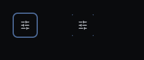
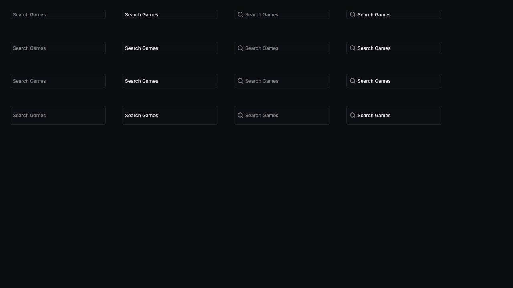
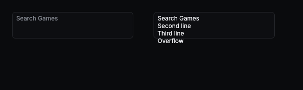
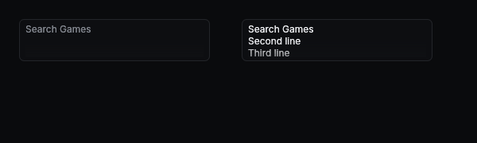

# Shared Widget Feedback

Captured from `tests/input_layout.rs` with software Vulkan. Before is base `d06ec7c`; after is this branch. Snapshot coverage also runs at 1.25x and 1.5x DPI.

| Item | Before | After |
| --- | --- | --- |
| 10: focus at container edges |  |  |
| 18: single-line centring |  |  |
| 21d: shared multiline padding |  |  |

10 shows an unclipped reference on the left and an identical button flush to all four container clip edges on the right. The inset ring preserves the complete outline.

18 shows heights 24, 32, 36 and 48pt, with plain placeholder/value then search placeholder/value in each row. Base already passes the requested centring tolerance; these images intentionally match. Geometry and raster ink centres stay within one physical pixel at 1280x720 and 1920x1080.

21d shows shared multiline placeholder and overflowing content. Removing egui's 64pt minimum viewport keeps scrolling text inside the existing inset. jclip's Feedback dialog separately uses a local `egui::TextEdit` at `crates/jclip-app/src/feedback.rs:122`; that caller still needs an app-level change. There is no j-ui prototype in this repository.
